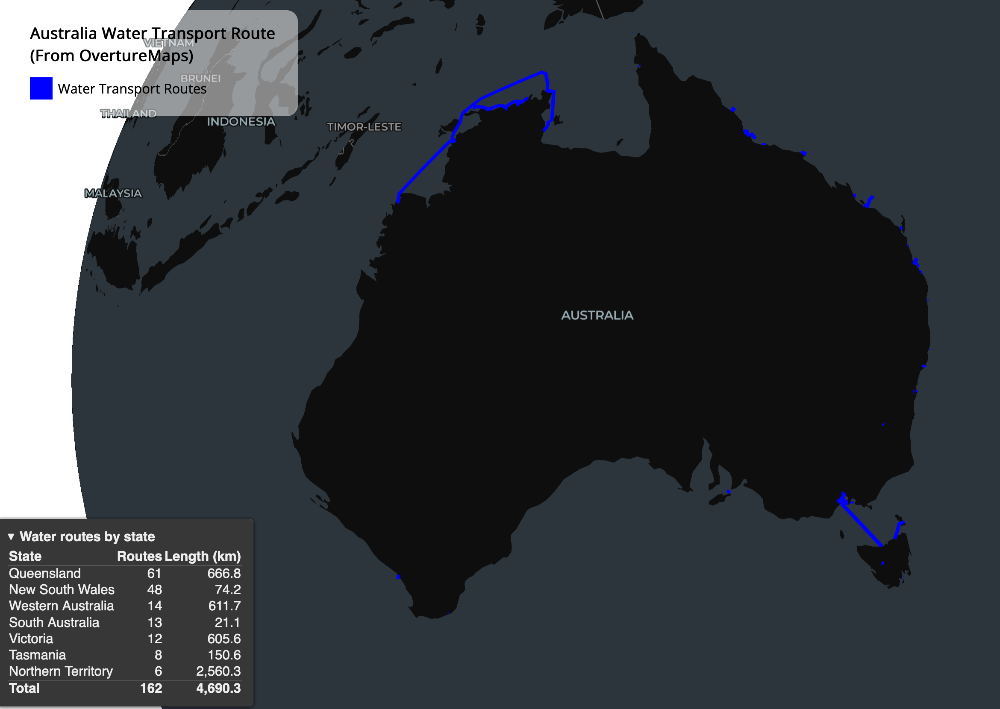
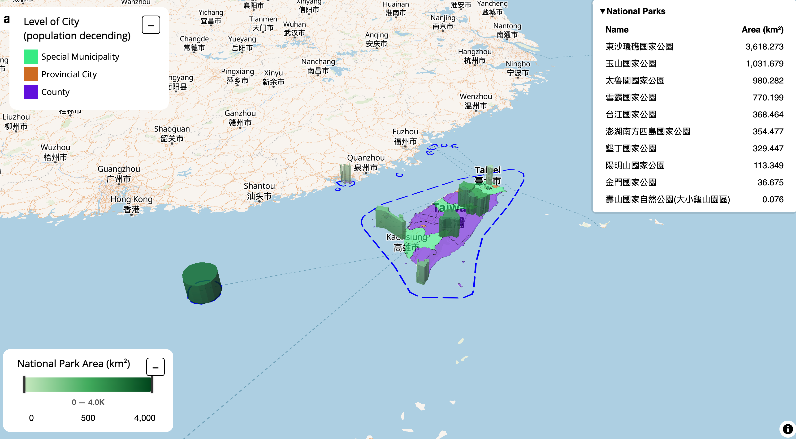

# 30DayMapChallenge2026

Data and mapping works for the [#30DayMapChallenge](https://30daymapchallenge.com/) 2026.

| Day | Theme  | Map                                                                                                                          | Script                                                     |
| --- | ------ | ---------------------------------------------------------------------------------------------------------------------------- | ---------------------------------------------------------- |
| 1   | Points | [Australia 2026 Meshblocks by Land Use](https://wilsonyungsh.github.io/interactive/30DayMapChallenge2026/day1_aus26_mb.html) | [Day1_abs_census_mb_pt.r](scripts/Day1_abs_census_mb_pt.r) |
| 2   | Lines  | [Australia Water Transport Routes](https://wilsonyungsh.github.io/interactive/30DayMapChallenge2026/day2_aus_water_routes.html) | [Day2_route1_highway_line.r](scripts/Day2_route1_highway_line.r) |
| 3   | Polygons | [Taiwan National Parks](https://wilsonyungsh.github.io/interactive/30DayMapChallenge2026/day3_tw_boundary_national_parks.html) | [Day3_tw_national_parks_polygon.R](scripts/Day3_tw_national_parks_polygon.R) |
| 4   | Clusters | [Where Industry Workers Live: Sydney, Melbourne & Brisbane](https://wilsonyungsh.github.io/interactive/30DayMapChallenge2026/day4_3gcc_top5_lisa.html) | [Day4_clustering.R](scripts/Day4_clustering.R) |

---

## Day 1 – Points: Australia's 2026 Census Meshblocks

🗺️ **[Open the interactive map](https://wilsonyungsh.github.io/interactive/30DayMapChallenge2026/day1_aus26_mb.html)**

2026 is an Australian Census year, so Day 1 starts with the smallest building block of the census geography: the **Mesh Block (MB)** from the ABS Australian Statistical Geography Standard (ASGS) 2026.

### What's on the map

- **Points**: each of the 374,803 Mesh Blocks is shown as a single point at its centroid.
- **Colour**: land use category of the Mesh Block. Education, Hospital/Medical and Transport are grouped as _Infrastructure_.
- **Point size**: scaled by the (log) number of Mesh Blocks in that land use category Australia-wide.
- **Popup**: Mesh Block code, SA2 name and land use.
- **Summary table**: Australia-wide Mesh Block count and area, with each land use's share of the total.

### Count vs area: two very different pictures

| Land use           |    MB count |     MB % |    Area (km²) |   Area % |
| ------------------ | ----------: | -------: | ------------: | -------: |
| Primary Production |      19,323 |     5.2% |     5,905,352 |    76.8% |
| Other              |       5,170 |     1.4% |     1,055,421 |    13.7% |
| Parkland           |      62,561 |    16.7% |       646,073 |     8.4% |
| Water              |       4,421 |     1.2% |        41,978 |     0.5% |
| Residential        |     248,975 |    66.4% |        33,572 |     0.4% |
| Industrial         |       7,730 |     2.1% |         3,520 |    <0.1% |
| Infrastructure     |      11,500 |     3.1% |         1,230 |    <0.1% |
| Commercial         |      15,123 |     4.0% |           949 |    <0.1% |
| **Total**          | **374,803** | **100%** | **7,688,095** | **100%** |

Mesh Blocks are designed to hold roughly similar numbers of dwellings, so they are tiny where people live and vast where they don't:

- **Residential** Mesh Blocks make up **two-thirds of all Mesh Blocks (66.4%)** but cover only **0.4% of the land**.
- **Primary Production** Mesh Blocks are only **5.2% of the count** but cover **over three-quarters (76.8%) of Australia**.

Counted by Mesh Block, Australia looks residential. Measured by area, it's farmland and outback. Plotting centroids makes this visible: points crowd into the cities and coast, and thin out to a sparse scatter across the interior.

### Data & tools

- **Data**: ABS ASGS Edition 2026 Mesh Blocks, via the `abs.geo` R package. Area is the ABS-supplied `area_albers_sqkm`.
- **Mapping**: [`mapgl`](https://walker-data.com/mapgl/) (MapLibre GL JS) in R, exported with `htmlwidgets`.
- **Script**: [scripts/Day1_abs_census_mb_pt.r](scripts/Day1_abs_census_mb_pt.r)

---

## Day 2 – Lines: Australia's Water Transport Routes

🗺️ **[Open the interactive map](https://wilsonyungsh.github.io/interactive/30DayMapChallenge2026/day2_aus_water_routes.html)**

Ferries, barges and other water-borne routes are an easily overlooked part of Australia's transport network. Day 2 maps every **water transport segment** in [Overture Maps](https://overturemaps.org/) that falls within an Australian state or territory.

### What's on the map

- **Lines**: each Overture `transportation/segment` with `subtype = 'water'`, clipped to Australian states and territories.
- **Popup**: route name, state and length (km).
- **Summary panels**: route count and total length by state (bottom-left), and the top 10 longest named routes (bottom-right).
- The map opens zoomed in on the Berowra Waters ferry on the Hawkesbury River, NSW.

### Many short hops vs a few long voyages

| State              |  Routes | Length (km) |
| ------------------ | ------: | ----------: |
| Queensland         |      61 |       666.8 |
| New South Wales    |      48 |        74.2 |
| Western Australia  |      14 |       611.7 |
| South Australia    |      13 |        21.1 |
| Victoria           |      12 |       605.6 |
| Tasmania           |       8 |       150.6 |
| Northern Territory |       6 |     2,560.3 |
| **Total**          | **162** | **4,690.3** |

- **NSW** has the second-most routes (48) but only **74 km** in total: mostly short river and harbour crossings.
- The **Northern Territory** has just **6 routes** but **2,560 km**, over half the national total, driven by long coastal routes across the Top End towards Western Australia.
- **Victoria's** 606 km comes mostly from the Bass Strait crossing to Tasmania. A route that crosses a state border is counted in each state it touches.

### Data & tools

- **Data**: [Overture Maps](https://overturemaps.org/) transportation theme (latest release, read from the catalog at run time), queried straight from S3 with DuckDB (`spatial`, `httpfs`). The bounding box comes from `osmdata::getbb()`, and state boundaries are ABS ASGS 2026 states via `abs.geo`.
- **Query**: [sql/road_extract_query.sql](sql/road_extract_query.sql)
- **Mapping**: [`mapgl`](https://walker-data.com/mapgl/) (MapLibre GL JS) in R, exported with `htmlwidgets`.
- **Script**: [scripts/Day2_route1_highway_line.r](scripts/Day2_route1_highway_line.r)

---

## Day 3 – Polygons: Taiwan's National Parks

🗺️ **[Open the interactive map](https://wilsonyungsh.github.io/interactive/30DayMapChallenge2026/day3_tw_boundary_national_parks.html)**

Taiwan has nine national parks and one national nature park. Day 3 draws them as 3D polygons over Taiwan's cities and counties, from Yangmingshan in the north to Dongsha Atoll out in the South China Sea.

### What's on the map

- **Base polygons**: Taiwan's cities and counties (GADM level 2), coloured by type: Special Municipality, Provincial City or County.
- **National parks**: extruded polygons, shaded from light to dark green by area. The area legend can be used to filter parks.
- **Dashed blue line**: Taiwan's full administrative boundary from OpenStreetMap, including the surrounding sea.
- **Popup**: park name and area (km²). A table of all parks by area sits in the top-right corner.

### Most of the park area is sea

| National park      | Area (km²) |
| ------------------ | ---------: |
| 東沙環礁國家公園 Dongsha Atoll | 3,618.3 |
| 玉山國家公園 Yushan | 1,031.7 |
| 太魯閣國家公園 Taroko | 980.3 |
| 雪霸國家公園 Shei-Pa | 770.2 |
| 台江國家公園 Taijiang | 368.5 |
| 澎湖南方四島國家公園 South Penghu Marine | 354.5 |
| 墾丁國家公園 Kenting | 329.4 |
| 陽明山國家公園 Yangmingshan | 113.3 |
| 金門國家公園 Kinmen | 36.7 |
| 壽山國家自然公園 Shoushan (大小龜山園區 only) | 0.1 |
| **Total** | **7,602.9** |

- **Dongsha Atoll** is nearly half (48%) of all national park area, and almost all of it is coral reef and ocean.
- The biggest land parks are the mountain parks along the Central Mountain Range: **Yushan**, **Taroko** and **Shei-Pa**.
- **Shoushan** only shows 0.08 km² because Nominatim returns just one small section of the park (大小龜山園區), not the whole park.

### Data & tools

- **City/county boundaries**: [GADM](https://gadm.org/) level 2, via the `geodata` R package.
- **National park and Taiwan boundaries**: OpenStreetMap, queried through the [Nominatim](https://nominatim.org/) search API with `httr2` (1 request per second, as the usage policy asks).
- **Area**: calculated in UTM zone 51N (EPSG:32651).
- **Mapping**: [`mapgl`](https://walker-data.com/mapgl/) (MapLibre GL JS) in R.
- **Script**: [scripts/Day3_tw_national_parks_polygon.R](scripts/Day3_tw_national_parks_polygon.R)

---

## Day 4 – Clusters: Where Industry Workers Live in Sydney, Melbourne & Brisbane

🗺️ **[Open the interactive map](https://wilsonyungsh.github.io/interactive/30DayMapChallenge2026/day4_3gcc_top5_lisa.html)**

Do people who work in the same industry live near each other? Day 4 looks for residential hotspots of workers in the five largest industries across Australia's three biggest east-coast cities, using the 2021 Census.

> **Note:** Census G56 counts employed people by **place of usual residence**, not place of work. These are clusters of where industry workers *live*, not where the jobs are.

### What's on the map

- **Polygons**: SA2s in Greater Sydney, Greater Melbourne and Greater Brisbane with more than 50 employed residents, coloured by Local Moran's I (LISA) cluster type: High-High (hotspot), Low-Low (coldspot), High-Low, Low-High or not significant (p ≥ 0.05).
- **Industry switcher** (top right): one layer per industry, one shown at a time.
- **City buttons** (bottom right): zoom to Brisbane, Melbourne or Sydney.
- **Dashed line**: official Greater Capital City Statistical Area (GCCSA) boundaries.
- **Popup**: SA2, city, resident workers in that industry, location quotient (LQ) and cluster type with its p-value.
- **Summary table** (bottom left, draggable and collapsible): employed residents in each top-5 industry and their share of the city's total.

### Method

1. **Location quotient (LQ)** for each SA2 and industry: the industry's share of the SA2's employed residents, divided by its share across the whole city. LQ > 1 means the industry is over-represented among local residents.
2. **Spatial weights**: 8 nearest neighbours by SA2 centroid (in EPSG:3577), row-standardised. Each city is analysed on its own, so a hotspot is relative to that city.
3. **Global Moran's I** (999 permutations) for the overall strength of clustering, and **Local Moran's I** (`localmoran_perm`, 999 permutations) to locate hotspots and coldspots.

### Same top 5 industries, different clustering

All three cities share the same top 5 industries (by employed residents), which together make up about 53% of employed residents in each city. How strongly each one clusters differs:

| Industry | Brisbane | Melbourne | Sydney |
| -------- | -------: | --------: | -----: |
| Professional, Scientific & Technical Services | 0.869 | 0.875 | 0.861 |
| Construction | 0.750 | 0.713 | 0.623 |
| Retail Trade | 0.573 | 0.512 | 0.650 |
| Education & Training | 0.553 | 0.583 | 0.473 |
| Health Care & Social Assistance | 0.321 | 0.536 | 0.551 |

_Global Moran's I of LQ; all p = 0.001._

- **Professional, Scientific & Technical Services** workers are the most clustered industry in every city (I ≈ 0.87). Around 40–45% of them live in hotspot SA2s, all in the inner city: New Farm and Paddington in Brisbane, North Sydney and Surry Hills in Sydney, Fitzroy and South Yarra in Melbourne.
- **Construction** is the most clustered industry after that in Brisbane and Melbourne, but its hotspots sit on the outer suburban fringe (Logan Village and Jimboomba, Warragamba and The Oaks, Kinglake and Whittlesea), the mirror image of the professional services pattern.
- **Health Care** is the largest industry everywhere (14–16% of employed residents) and the least clustered, especially in Brisbane (I = 0.32): hospitals and aged care are spread across the whole city, and so are the people who work in them.

### Data & tools

- **Data**: ABS Census of Population and Housing 2021, table G56 Industry of employment by occupation (SA2, place of usual residence), via the ABS Data API with `readabs`. SA2 and GCCSA 2021 boundaries via `strayr`.
- **Spatial statistics**: `spdep` (k-nearest-neighbour weights, `moran.mc`, `localmoran_perm`).
- **Mapping**: [`mapgl`](https://walker-data.com/mapgl/) (MapLibre GL JS, CARTO Voyager basemap) in R, exported with `htmlwidgets`.
- **Script**: [scripts/Day4_clustering.R](scripts/Day4_clustering.R)
